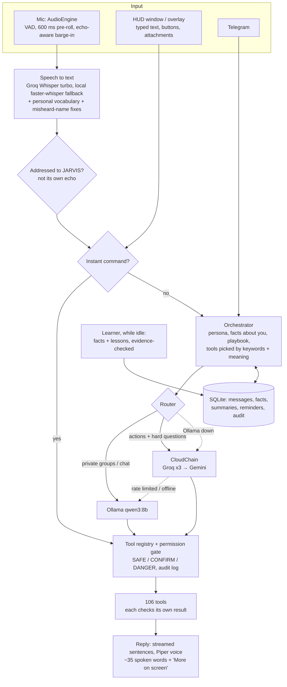
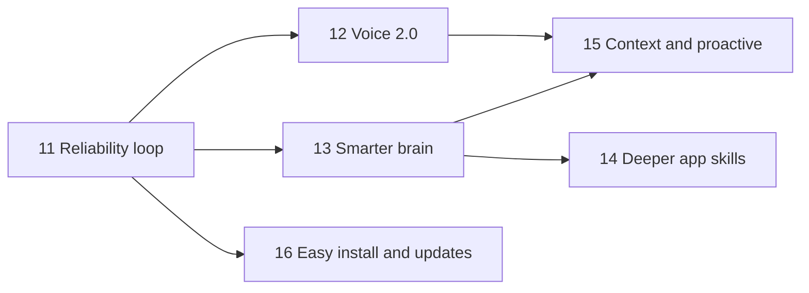

# JARVIS: Architecture & Plan (v2)

**Goal:** a JARVIS-style voice assistant for Windows that costs **$0**. It runs on your own GPU, works offline,
keeps private things private, and uses free cloud tiers only as an optional boost.

**Status (2026-11-21):** **v1.1.0.** Every phase of the original plan (0–10) is built, along with a lot it
didn't foresee. This document describes JARVIS **as built** and the **roadmap ahead**. The original
pre-build blueprint, with its starter code, is preserved at tag
[`v1.0.0`](https://github.com/anwin-kp/jarvis-assistant/blob/v1.0.0/JARVIS_PLAN.md).

- **Setting up?** See [SETUP.md](SETUP.md).
- **Day-to-day state and backlog:** see [PROGRESS.md](PROGRESS.md).

---

## Contents

1. [JARVIS today](#1-jarvis-today)
2. [Design principles](#2-design-principles)
3. [Architecture as built](#3-architecture-as-built)
4. [Technology: planned vs. built](#4-technology-planned-vs-built)
5. [Models, VRAM and speed](#5-models-vram-and-speed)
6. [What's done](#6-whats-done)
7. [Roadmap ahead (phases 11–16)](#7-roadmap-ahead)
8. [Security & privacy](#8-security--privacy)
9. [Quality: how we know it works](#9-quality-how-we-know-it-works)
10. [Known pitfalls on Windows](#10-known-pitfalls-on-windows)
11. [Two apps](#11-two-apps)

---

## 1. JARVIS today

| | |
|---|---|
| **Tools** | 106, in 19 groups: system, files, web, email, media, windows, tabs, screen, utility, reminders, notes, memory, … |
| **Instant commands** | 26 patterns answered in ~0.1 s with no AI call (volume, media, apps, tabs, email "mark as read", …) |
| **Task playbooks** | 22 step-by-step recipes for multi-step jobs, learned and corrected from use |
| **Tests** | 252 unit tests (Windows CI) · 104-case tool-selection eval at **99%** |
| **Speed** (median, 411 real turns) | instant 0.0 s · local model 1.5 s · cloud 4.7 s (multi-step actions with verification) |
| **Idle cost** | ~1.3% CPU, ~1.4 GB RAM, ~6.9 GB VRAM (the model stays loaded for instant replies) |

What it does, in one breath: always-listening voice with live captions and interrupting. Local Qwen3 plus free
cloud brains, routed by privacy and difficulty. It controls your PC: apps, windows, tabs, files, settings, media and
any app's UI. Gmail and Calendar, Spotify, Telegram remote, Home Assistant. Memory that learns about you while idle.
Reminders, a morning briefing, a weekly self-check, offline fallbacks, a HUD window or a transparent desktop
overlay, and a kill switch.

---

## 2. Design principles

These are the original four, plus three learned the hard way.

1. **Local-first.** Speech, the AI brain, memory and voice all run on your PC. The cloud is optional and never
   required: every cloud path falls back to local.
2. **The model never touches the OS.** It can only *request* tools. The **tool registry and permission gate**
   (in code, not in the prompt) decides: run, ask you, or refuse.
3. **Swappable engines** behind small interfaces (`transcribe`, `speak`, `respond`), all set in `config.yaml`.
4. **One event stream to every UI**: console, tray, HUD window and overlay all subscribe to the same events.
5. **Verify, don't trust** *(learned)*. Action tools check that the result really happened before JARVIS says so
   ("Closed notepad (checked: no window or process left)"). A reply that claims an action no tool backed up gets
   pushed back. Small models bluff; checked results don't.
6. **Deterministic first** *(learned)*. Anything a rule can do reliably (instant commands, maths, conversions,
   tab closing) never goes through the model. The model is for language and judgement.
7. **Evidence before fixes** *(learned)*. Real failures come from the weekly self-check, the logs and saved voice
   recordings. Each fix starts with a root cause and a deterministic test, never a chain of quick patches.

---

## 3. Architecture as built

**Module map**

| Area | Where |
|---|---|
| App loop, voice turns, approvals, interrupts | `src/jarvis/__main__.py` |
| Wiring | `src/jarvis/app.py` |
| Turn logic, system prompt, tool choice | `core/orchestrator.py`, `llm/tool_groups.py`, `llm/semantic.py` |
| Instant commands, kill/sleep/stop words | `core/fast_intents.py`, `core/commands.py` |
| Brains and router | `llm/ollama_brain.py`, `llm/cloud_brain.py` |
| Permission gate | `tools/registry.py` |
| Tools | `tools/*.py`, `integrations/*.py`, `agent/operator.py` (operate any app), `agent/uia.py` (one COM thread) |
| Voice | `audio/engine.py` (the only mic owner), `stt/`, `tts/`, `audio/wakeword.py`, `audio/voiceid.py` |
| Memory and learning | `memory/store.py`, `memory/learner.py`, `memory/personal_data.py` |
| Playbooks | `tasks/playbooks.py`, `knowledge/tasks/*.yaml` |
| UI | `ui/hud.py` + `ui/web/index.html` (window), `ui/overlay.py` (overlay branch), `ui/tray.py` |
| Health | `review.py` (weekly self-check), `evals.py`, `voicetest.py` |

**Turn safety net:** at most 8 tool steps per turn. "Stop" cancels both brains between every step and tool. A tool
that ran is never re-run on another provider (the cloud hands its partial results over instead). The approval
prompt holds any other events until you answer.

---

## 4. Technology: planned vs. built

| Layer | Planned (v1) | Built | Why it changed |
|---|---|---|---|
| Local brain | Ollama + Qwen3 8B | **Same**, `num_ctx` 8192, thinking only for hard questions | Worked as planned |
| Cloud brain | Groq *or* Gemini, off by default | **Router "smart" mode:** actions and hard questions go to Groq `gpt-oss-120b` → `gpt-oss-20b` → `qwen3.8-27b` → Gemini flash-lite; private groups stay local | The local 8B picked wrong tools and claimed actions on multi-step tasks. Each Groq model has its own 8k tokens/min |
| Speech to text | faster-whisper `small` (GPU) | **Groq Whisper large-v3-turbo**, local Whisper for offline use and live captions | Accuracy on your accent and names. Ranked personal vocabulary and after-recognition fixes on top |
| Voice | pyttsx3 → Kokoro | **Piper** (`en_GB-alan`), a voice per language; SAPI fallback | Natural, fast on CPU, many languages |
| Wake word / VAD | openWakeWord, webrtcvad | **Same**, plus an always-listening mode needing "Jarvis" after a quiet minute | |
| Interrupting | Optional | **Built:** echo learning, peak-based echo level, JARVIS's voiceprint | Talking over it is how people use voice assistants |
| Scheduler | APScheduler 3 | **Own SQLite scheduler** | Smart App Control blocked SQLAlchemy's native code |
| Semantic memory / docs | ChromaDB | **SQLite + `nomic-embed-text` vectors** (CPU) | One fewer dependency. Fast enough at personal scale |
| HUD | pywebview | **Edge app window** (main); **PySide6 overlay** (overlay branch) | Edge ships with Windows, so no extra dependency; the overlay needs real transparency and click-through |
| App automation | pywinauto | **UI Automation + an "operator"** (screenshot + OCR + vision model, acts like a person) | Most apps expose too little to UI Automation alone |
| Web search | ddgs | **ddgs, 5 engines at once, first answer wins**, 10-min cache | Single engines are often empty |
| Secrets | keyring | **Same** (Windows Credential Manager) | |

---

## 5. Models, VRAM and speed

**VRAM budget on an 8 GB RTX 5060 (measured):** qwen3:8b at 8k context ≈ 6.1 GB. Local Whisper for captions and
offline use ≈ 0.8 GB. The embedding model runs on the CPU. Total ≈ 6.9 GB. Gaming mode unloads the model when a game
starts.

| Context (`num_ctx`) | Extra VRAM | |
|---|---|---|
| 8k (JARVIS) | ~1.2 GB | Fits |
| 64k | ~9 GB | Doesn't fit: spills to the CPU, several times slower |

**Where time goes:** speech recognition ~0.5 s · instant commands ~0.1 s · a local reply's first spoken word
~1–2 s · cloud replies wait for the whole answer (not streamed yet: see phase 12).

---

## 6. What's done

| Phase (v1 plan) | Status | Notes |
|---|---|---|
| 0 Environment | ✅ | uv, python.org Python (Smart App Control), Windows CI |
| 1 Text brain + tools | ✅ | Registry, tiers, tool groups + semantic choice |
| 2 Voice loop | ✅ | Streaming replies, sentence by sentence |
| 3 PC control + permissions | ✅ | Plus windows, tabs, UI automation, operator |
| 4 Memory | ✅ | Plus semantic recall, idle learning, lessons, conversation survives restarts |
| 5 Hands-free | ✅ | Always listening, wake word, barge-in, live captions, voice ID |
| 6 Reminders + briefing | ✅ | Briefing when you sit down; timers show time left |
| 7 Email + calendar | ✅ | Gmail read/draft/send (approved), mark/archive/trash; Calendar |
| 8 HUD | ✅ | Window, attachments, memory panel, approvals, cut-in; overlay app |
| 9 Cloud fallback | ✅ | Smart router, chain of providers, offline answers with their age |
| 10 Advanced | ✅ (most) | Home Assistant, Telegram, MCP servers, plugins, personas, proactive alerts, document Q&A, screen vision |

**Beyond the plan:** task playbooks, weekly self-check, last-known offline answers, exact-maths/units/currency
tools, Windows media-session awareness, performance work (frame cap, overlay strip window), SETUP.md.

---

## 7. Roadmap ahead

The order comes from evidence: the weekly self-check, timing logs and live tests. Each phase has a measurable
"done when".

### Phase 11: Reliability loop 🟢 (next)
**Why:** the self-check flagged 39% of turns in the first week. Most are fixed now, but the loop from failure to fix
is still manual.
- Each weekly self-check turns its top failures into **eval cases** automatically (with your review), so a fix
  can't silently regress.
- **Recorded voice fixtures** (from `data/voice-log`) as a regression suite for speech recognition and echo
  handling.
- Run the eval in `--local` mode before every release.

**Done when:** flagged turns (excluding interruptions) stay **under 15%** for two weeks, and every release runs the
eval.

### Phase 12: Voice 2.0 🟢
**Why:** interrupting over a loud Bluetooth speaker needs a raised voice, and cloud replies feel slow (4.7 s median
before the first word).
- **Real echo cancellation:** subtract JARVIS's own playback, a known signal, from the mic, using WebRTC AEC3 or
  speexdsp. This is the root fix; today's echo *estimation* is the workaround.
- **Stream cloud replies** (Server-Sent Events) and speak the first sentence while the rest arrives.
- Optional custom wake word trained on your voice. Voice ID on by default once enrolled.

**Done when:** interrupting works at normal volume with speakers in a recorded test, and the cloud's first word
arrives in under 2 s.

### Phase 13: Smarter brain 🟡
- **Eval-driven model upgrades:** compare new ~8B tool models against qwen3:8b on the 104-case eval, and switch
  only on a win.
- **Memory quality:** confidence and source per fact, resolving conflicting facts ("moved to Bangalore"), letting
  stale facts expire.
- **Plan, then check:** multi-step tasks write a short plan, run it, and verify each step against the plan.

**Done when:** eval ≥ 99% on the new model, and no contradicted facts after a month of use.

### Phase 14: Deeper app skills 🟡
- Purpose-built tools for the apps you use most. Candidates from your logs: VS Code (open project, run a task),
  File Explorer (go to, select, rename by pattern), WhatsApp / Teams desktop (read only, then send with approval).
- Clipboard-aware actions ("summarize what I copied", already there) extended to files and images.

**Done when:** your top-10 app requests run without `operate_app` (one-shot, checked).

### Phase 15: Context & proactive 🔵
- Know the active app and window title: "what's this error?" without saying where.
- **Routine learning:** "every weekday at 9 you open Outlook and Teams". JARVIS offers it as a routine and never
  does it unasked.
- Focus sessions with Do Not Disturb where Windows allows it; smarter meeting prep (who, agenda, related email).

**Done when:** at least 3 useful suggestions a week, which you rate as helpful more often than not.

### Phase 16: Easy install & updates 🔵
- `jarvis.ps1 update`: pull, sync (with the right extras), restart, and show what's new.
- A first-run wizard in the HUD: microphone check, keys (with links), location, apps allowlist.
- Packaging stays script-based: unsigned `.exe` builds (PyInstaller / Nuitka) are blocked by Smart App Control.

**Done when:** a new user goes from `git clone` to a working voice assistant with Groq in under 20 minutes, without
reading code.

---

## 8. Security & privacy

**Permission tiers (enforced in code)**

| Tier | Behaviour | Examples |
|---|---|---|
| SAFE | Runs automatically | Read info, volume, reminders, search, open allowlisted apps |
| CONFIRM | Asks, unless listed in `security.no_approval` | Close apps and tabs, click or type in apps, create events, drafts |
| DANGER | **Always** asks, by keyboard or HUD button, never by voice | Delete files (Recycle Bin), send email, shutdown, kill process, PowerShell, cleaning downloads |

- A risky step inside an approval-free tool still asks: clicking "Buy" or "Pay", Alt+F4, moving files to the Bin.
- **Never leaves the PC:** files, documents, email, screen, clipboard, notes and browser-tab content (private groups
  never reach the cloud), plus memory, unless you set `memory.share_with_cloud`. `/private` forces everything local.
- **Prompt injection:** web, email and file content is wrapped as untrusted data. The permission gate is the real
  protection.
- **Network:** HUD on `127.0.0.1` with a per-launch token. Web tools refuse LAN and localhost addresses.
- **Keys** live in Windows Credential Manager. The private `data/` folder is git-ignored. There's an audit log of
  every tool call, a kill switch (icon, "Jarvis, shut down", `/kill`), and a single-instance lock.
- The PowerShell tool is off by default: read-only prefixes only, with no pipes, subexpressions, .NET calls or
  variables.

---

## 9. Quality: how we know it works

| Check | What | When |
|---|---|---|
| Unit tests | 252, deterministic (fake brains, fake tab strips, temp folders) | Every PR (Windows CI) |
| Tool-selection eval | 104 real phrasings → expected tools (`jarvis.ps1 eval`, `--local`, `--cloud`) | Prompt, routing or tool changes |
| Weekly self-check | Flags failed turns (empty, corrected, repeated, tool errors, interrupted) → HUD notice + `data/review/` | Automatic, weekly |
| Live smoke test | Real commands through the HUD websocket; timings and error counts from the log | Before releases |
| Voice test | Your own recordings through every recognition engine (`jarvis.ps1 voice-test`) | Voice changes |
| Performance baseline | Idle CPU, RAM, GPU and VRAM per process; reply timings | Performance changes |

---

## 10. Known pitfalls on Windows

1. **Smart App Control** blocks unsigned native code: uv's own Python builds, `.exe` shims, some wheels. Use
   python.org Python (`python-preference = "only-system"`), run `python -m …`, and test-import new native
   dependencies at once.
2. **RTX 50-series:** `int8_float16` isn't supported by CTranslate2; use `float16`. Keep CPU fallbacks.
3. **Ollama's context slider** doesn't affect JARVIS (`num_ctx` is sent per request). Don't raise the global default
   past 16k on 8 GB.
4. **Mixed-DPI monitors** (200% laptop + 100% screen): a window whose invisible border crosses onto the other
   monitor is rescaled. Move first, then size, and never past the screen edge.
5. **COM threading:** WinRT and pywinauto need different thread modes, so UI automation runs on one dedicated
   thread and WinRT on its own.
6. **Groq free tier:** 8k tokens/min per model. Requests are kept small (about 10 tools, the last 3 exchanges,
   only the matching examples).
7. **Google OAuth "Testing" mode:** sign-in expires after ~7 days.
8. **OneDrive-redirected folders:** known folders are resolved through Windows, never assumed.
9. **Microphone privacy setting** can silently block desktop apps.
10. **Overlay branch:** always `uv sync --extra overlay`; a plain `uv sync` uninstalls the Qt packages.

---

## 11. Two apps

| | Window app | Desktop overlay app |
|---|---|---|
| Branch | `develop` → released on `main` | `feature/desktop-overlay` only (never merged) |
| UI | Edge app window HUD | Transparent PySide6 overlay: corner or centre, click-through, hides over games |
| Install | `uv sync` | `uv sync --extra overlay` |

Shared improvements land on `develop` and are merged into the overlay branch. Overlay-only work goes straight to
its branch.
