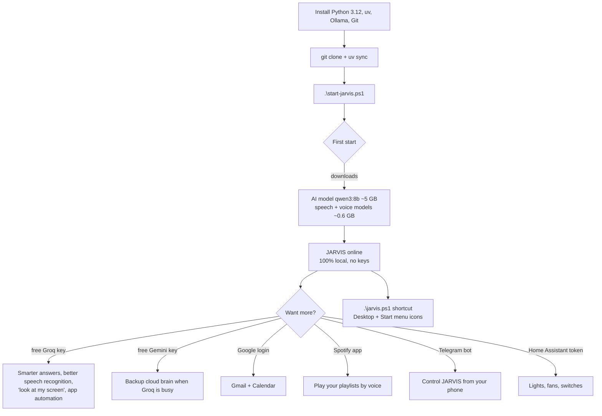
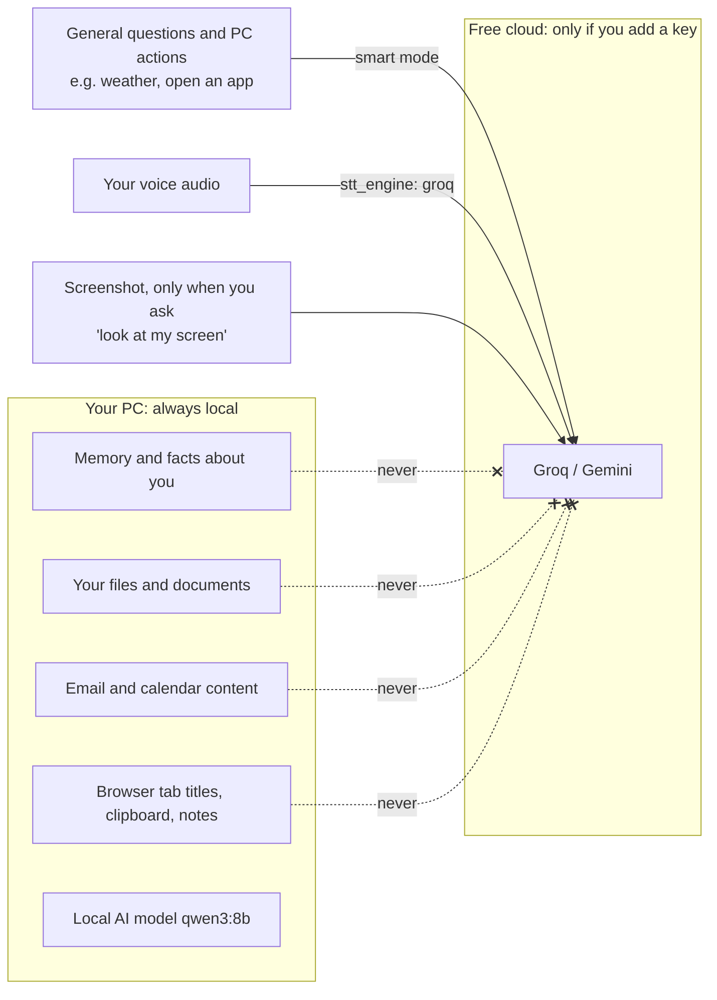
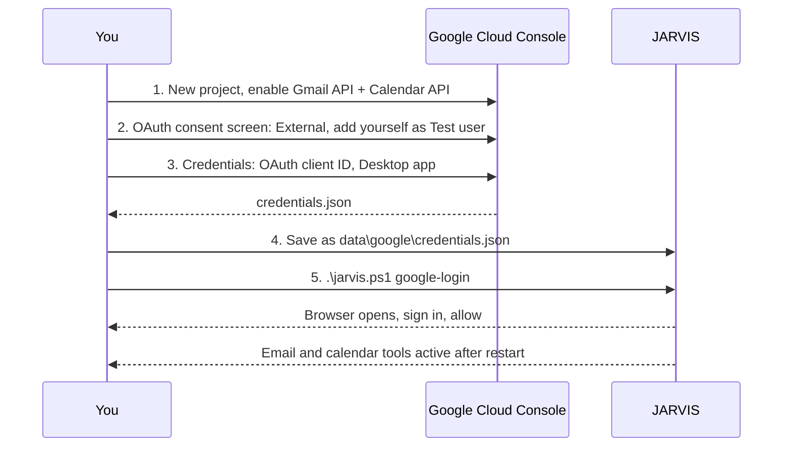
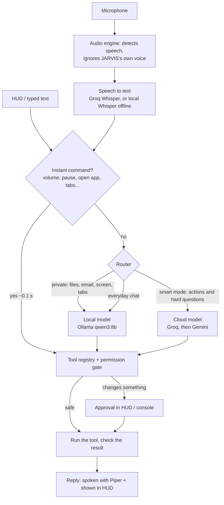

# Setting up JARVIS

A step-by-step guide for a fresh clone. **Every API key is optional.** With no keys at all, JARVIS still runs
100% offline on your own PC. Each key you add switches on extra features, as listed below.

**Time:** about 20 minutes for the basics (most of it downloads), plus 5 minutes per optional integration.

---

## 1. What you need

| | Requirement | Why |
|---|---|---|
| OS | **Windows 10 or 11** | It uses Windows features: voices, OCR, UI Automation, media keys |
| GPU | **NVIDIA, 8 GB VRAM** recommended (6 GB works) | The local AI model (~6 GB). It also runs on the CPU, but slowly |
| RAM | 16 GB+ | |
| Disk | ~10 GB free | AI model 5.2 GB, speech models ~1 GB, Python packages ~2 GB |
| Mic + speakers | A headset works best | Talking over JARVIS to interrupt works best when its voice doesn't echo back into the mic |

## 2. The setup at a glance



## 3. Install (required)

Open **PowerShell** and run:

```powershell
# 1. Tools (Python must be the python.org build: see "Smart App Control" below)
winget install Python.Python.3.12 astral-sh.uv Ollama.Ollama Git.Git

# 2. Close and reopen PowerShell (so the new tools are on PATH), then:
git clone https://github.com/anwin-kp/jarvis-assistant.git
cd jarvis-assistant
uv sync

# 3. Start it (downloads the AI model on first run if it's missing)
.\start-jarvis.ps1
```

Not sure everything is in place? `.\jarvis.ps1 doctor` checks Python, packages, Ollama, the AI model, the GPU,
the microphone and your keys, and tells you the exact next step for anything missing.

When the HUD window opens and you hear **"JARVIS online"**, it works. Say **"Jarvis, what time is it?"**

Then add desktop and Start menu icons (one click to start, plus a **Kill JARVIS** icon):

```powershell
.\jarvis.ps1 shortcut
.\jarvis.ps1 autostart-on     # optional: start with Windows
```

> **Smart App Control.** If Windows Smart App Control is on, it blocks unsigned programs, including the Python
> that uv would download for itself. This project is set to use only the Python installed on your system
> (`python-preference = "only-system"`), so install **Python 3.12 from python.org or winget** *before* running
> `uv sync`. If you see *"An Application Control policy has blocked this file"*, that's the cause.

## 4. API keys: which one unlocks what

All keys are **free**. They are stored in **Windows Credential Manager** (never in files, never in git), with:

```powershell
.\jarvis.ps1 set-key <name>                  # paste the key when asked
.\jarvis.ps1 set-key <name> -FromClipboard   # or copy it first: avoids typos
```

| Key name (`set-key …`) | Where to get it | What it switches on | Without it |
|---|---|---|---|
| `groq` ⭐ recommended | [console.groq.com/keys](https://console.groq.com/keys), key starts with `gsk_` | **Smart mode**: hard questions and actions go to a much bigger free model · **better speech recognition** (Whisper large-v3-turbo) · **"look at my screen"** · **operate any app** (clicks and types like a person) · image attachments | Everything runs on the local model and local Whisper. No screen vision or app automation |
| `gemini` | [aistudio.google.com/apikey](https://aistudio.google.com/apikey), starts with `AIza` | A backup cloud brain when Groq's free per-minute limit is reached; also a fallback for app automation | When Groq is busy, the local model answers |
| `openrouter` | [openrouter.ai/keys](https://openrouter.ai/keys) | Alternative cloud provider (`llm.cloud.provider: openrouter`) | Not needed if you use Groq |
| `telegram` | Telegram app → **@BotFather** → `/newbot` | Text JARVIS from your phone | No phone remote |
| `home_assistant` | Home Assistant → Profile → Security → *Long-lived access token* | Smart home (lights, switches, fans, media players). Locks and alarms are never allowed | No smart home |
| `spotify_client_id` | See [Spotify](#spotify) below (needs **Spotify Premium**) | "Play my workout playlist", queue, like, volume | Media keys and YouTube still work |
| *(Google: a file, not a key)* | See [Gmail & Calendar](#gmail--google-calendar) below | Read, triage and draft email; calendar events and meeting reminders | No email or calendar |

### What leaves your PC (and what never does)



- Type `/private` to force **everything** to stay local until you switch it off.
- To keep your voice local too, set `voice.stt_engine: local` in `config/config.yaml`.
- What JARVIS has learned about you is sent to the cloud only if you set `memory.share_with_cloud: true`
  (off by default).

## 5. Optional integrations, step by step

### Groq (recommended, 2 minutes)

1. Sign in at [console.groq.com](https://console.groq.com) (Google sign-in works).
2. **API Keys → Create API Key**, then copy it.
3. `.\jarvis.ps1 set-key groq -FromClipboard`
4. `.\jarvis.ps1 restart`

The default config already uses Groq in **smart** mode (`llm.mode: smart`). Free tier: about 8k tokens per minute
per model. JARVIS rotates through three Groq models, then Gemini, then the local model.

### Gmail & Google Calendar



- Permissions requested: read and organise mail (never permanent delete), write drafts, manage calendar events.
  **Sending email always asks you first.**
- While the Google app is in *Testing* mode, Google expires the sign-in after ~7 days. Run `google-login` again
  when JARVIS says so.

### Spotify

Needs **Spotify Premium** (Spotify only allows playback control for Premium accounts).

1. Go to [developer.spotify.com/dashboard](https://developer.spotify.com/dashboard) → **Create app**.
2. Redirect URI: `http://127.0.0.1:8888/callback` (exactly this). API: **Web API**.
3. Open the app's **Settings** and copy the **Client ID** (32 characters). No secret is needed.
4. `.\jarvis.ps1 set-key spotify_client_id -FromClipboard`
5. `.\jarvis.ps1 spotify-login` (the browser opens: allow access)
6. `.\jarvis.ps1 restart`, then: *"Jarvis, play my liked songs"*

### Telegram (phone remote)

1. In Telegram, message **@BotFather** → `/newbot` → copy the token.
2. `.\jarvis.ps1 set-key telegram -FromClipboard`, then `.\jarvis.ps1 restart`
3. Message your new bot once. JARVIS shows your **chat id** in the HUD.
4. Put it in `config/config.yaml` → `telegram.allowed_chat_id: <id>` and restart. Only that chat is answered,
   and actions that need approval are refused from the phone.

### Home Assistant

1. Home Assistant → your profile → **Security → Long-lived access tokens → Create**.
2. `.\jarvis.ps1 set-key home_assistant -FromClipboard`
3. `config/config.yaml` → `home_assistant.url: http://homeassistant.local:8123`, then restart.

### Voice ID (only obey your voice)

`.\jarvis.ps1 enroll-voice` (read a few sentences), then set `voice.voice_id.enabled: true`.

### Coding and PC control (no setup needed)

- **Your code projects** are found automatically (git repos in your user folders and `C:\<folder>\`; add others
  under `coding.projects`). Ask: *"what changed in my portfolio"*, *"run the tests in modbus codec"*,
  *"where is login handled in ark sales"*, *"open jarvis in VS Code"*.
- **Code changes**: *"fix the failing test in modbus codec"* starts the coding agent. It works in the background on
  its own git branch with free models (Groq, then Gemini), so your files are untouched; then say *"show the
  changes"*, *"merge it"* or *"discard it"*. Code goes to the cloud for this; `coding.private: true` keeps it local.
- **PC**: *"switch to my headset"*, *"install VLC"*, *"update my apps"*, *"start work mode"*, *"rewrite the selected
  text politely"*, *"what starts with Windows"*, *"how's my battery"*, *"organize my downloads"*.
- **Offline vision** (optional, ~3 GB): `ollama pull qwen3-vl:4b` lets *"what's on my screen"* work without the cloud.

## 6. How a request flows



**Safety tiers:** *safe* tools just run · *confirm* tools ask (unless listed in `security.no_approval`) ·
*danger* tools (delete files, send email, shutdown, kill process) **always** ask, by keyboard or the HUD button,
never by voice alone. Say or type **"stop"** anytime. The **Kill JARVIS** icon stops everything.

## 7. Make it yours: `config/config.yaml`

| Setting | What to change |
|---|---|
| `security.app_allowlist` | Apps JARVIS may open/close: `name: program.exe` |
| `security.allowed_roots` | Folders it may read/search (documents, downloads, ... or full paths) |
| `security.no_approval` | Everyday actions that run without asking |
| `voice.vocabulary` | Names and places you say often (better recognition) |
| `voice.listen_mode` | `always` · `wake_word` ("Hey Jarvis") · `push` (Enter / Talk button) |
| `voice.languages` / `voice.voices` | Languages you speak, and the reply voice for each |
| `location.home` | Your city, if Windows location is off or wrong |
| `gaming.processes` | Your games' `.exe` names: JARVIS frees the GPU while they run |
| `briefing` | Morning briefing time |
| `persona` | `default` · `butler` · `casual` · `terse` (or write your own in `config/personas/`) |
| `llm.mode` | `smart` (default) · `local` (never cloud) · `cloud_first` |

Restart after changes: `.\jarvis.ps1 restart`.

## 8. Everyday commands

```powershell
.\jarvis.ps1 update        # get the latest version (pull, sync packages, restart, show what's new)
.\jarvis.ps1 doctor        # check the setup and get the next step for anything missing
.\jarvis.ps1 status        # is JARVIS / Ollama / the model running? GPU memory
.\jarvis.ps1 restart       # after config changes
.\jarvis.ps1 logs -Follow  # watch the log (data\logs\jarvis.log)
.\jarvis.ps1 free          # unload the AI model from the GPU now
.\jarvis.ps1 review        # what went wrong this week (self-check)
.\jarvis.ps1 voice-test    # measure speech recognition on your voice
kill-jarvis.cmd            # emergency stop: JARVIS, HUD, model and Ollama
```

## 9. Optional: the desktop overlay version

Besides the HUD window there's a **transparent desktop overlay** (the reactor in a screen corner, replies
floating beside it, Ctrl+Alt+J to type). It lives on the `feature/desktop-overlay` branch:

```powershell
git checkout feature/desktop-overlay
uv sync --extra overlay        # IMPORTANT: always include --extra overlay on this branch
```

> A plain `uv sync` on this branch **uninstalls** the overlay's Qt packages (they're an optional extra).

## 10. Troubleshooting

| Symptom | Fix |
|---|---|
| *"An Application Control policy has blocked this file"* | Smart App Control: install Python 3.12 from python.org / winget, delete `.venv`, run `uv sync` again |
| *"Can't reach Ollama"* | Start Ollama from the Start menu, or run `ollama serve` |
| *"Model qwen3:8b isn't downloaded"* | `ollama pull qwen3:8b` |
| JARVIS doesn't react to speech | Check the mic in Windows Sound settings. After a quiet minute in `always` mode it needs its name: *"Jarvis, …"* |
| It interrupts itself while talking | Speaker echo: use a headset, or raise `voice.barge_in_rms` |
| Cloud answers stop / "rate limited" | Free-tier limit: it falls back automatically. Adding a `gemini` key gives one more backup |
| Gmail stopped working after a week | `.\jarvis.ps1 google-login` (Testing-mode sign-ins expire) |
| Spotify: "needs a Premium account" | Spotify only allows playback control with Premium |
| Something else | `.\jarvis.ps1 logs`, then the last lines of `data\logs\jarvis.log` |

Your data (memory, logs, models, tokens) lives in `data\`, which is git-ignored. Back that folder up to keep
what JARVIS knows about you.
